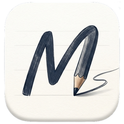
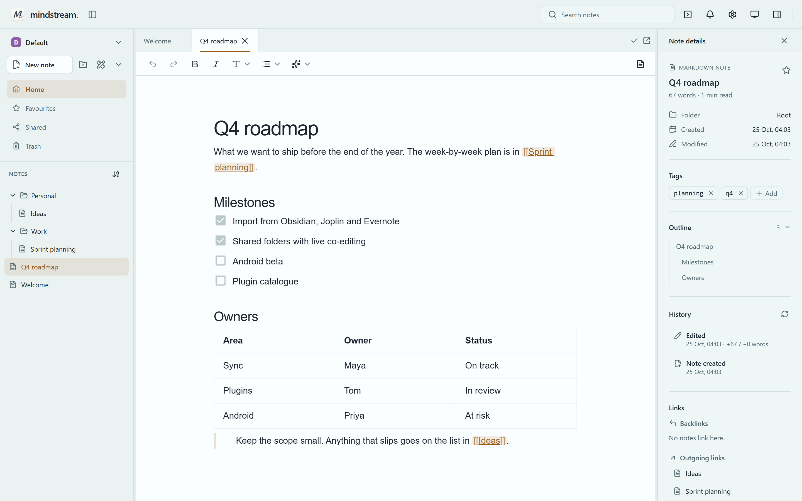

<div align="center">



# Mindstream Notes

Local-first notes with handwriting, PDFs and boards, and encrypted sync through
a server you host yourself.

[](https://github.com/jannikgohr/mindstream-notes/releases/latest)
[](https://codecov.io/gh/jannikgohr/mindstream-notes)
[](#license)

</div>

<picture>
  <source media="(prefers-color-scheme: dark)" srcset="docs/images/screenshot-dark.png">
  
</picture>

Your notes live in a database on your device, and the app works without an
account. Sync is optional and end-to-end encrypted. The server it talks to is in
this repository, so you run it yourself.

The desktop app runs on Windows, Linux and macOS. Android is a work in progress.
The project is under active development, so expect sharp edges.

## Features

- **Several kinds of note.** Markdown with WYSIWYG, source and split views,
  handwritten notes, drawing canvases, PDFs you can write on, kanban boards, and
  Typst documents with a live preview.
- **Links between notes.** `[[wikilinks]]` and `@mentions`, backlinks, tags,
  search, and an outline of every note.
- **History and backups.** Every note keeps its earlier versions. Deleted notes
  go to the trash first, and a backup holds a whole vault.
- **Sync on your own server.** Encrypted sync, shared folders and live
  co-editing.
- **Import and export.** Bring notes in from Markdown folders, Obsidian, Joplin
  and Evernote, and export every note type.
- **Spelling and grammar.** Spell checking with the app's own dictionaries, and
  grammar checking through a LanguageTool server.
- **Plugins.** Sandboxed WebAssembly components, written in Rust or TypeScript.
- Several vaults side by side, and an English and German interface.

## Install

Download the app from the
[releases page](https://github.com/jannikgohr/mindstream-notes/releases). It
works on its own straight away. To sync between devices, set up the server with
the [self-hosting quick start](docs/self-hosting.md).

## Documentation

The [documentation index](docs/README.md) lists every guide. Good places to
start:

- [Importing notes](docs/import.md) from other apps
- [Backup and restore](docs/backup-and-restore.md)
- [Known limitations](docs/known-limitations.md), worth a read before filing a
  bug about sync or history
- [Plugins](docs/plugins.md), for writing your own

## Development

```shell
pnpm install      # also installs the git hooks
pnpm dev          # the UI in a browser, on an in-memory mock store
pnpm tauri-dev    # the desktop app
```

[docs/BUILDING.md](docs/BUILDING.md) has the per-OS prerequisites and release
builds, and [CONTRIBUTING.md](CONTRIBUTING.md) the commit conventions, hooks and
tests. Architecture, design notes and test docs are in the
[internal documentation](docs/internal/README.md).

## License

The app is available under the [MIT](LICENSE-MIT) or the
[Apache 2.0](LICENSE-APACHE) licence, at your option. The sync server in
[`backend/server/`](backend/server) is under the
[AGPL-3.0-only](backend/server/LICENSE), and a few vendored parts keep their own
licences. [REUSE.toml](REUSE.toml) gives the licence of every file.
