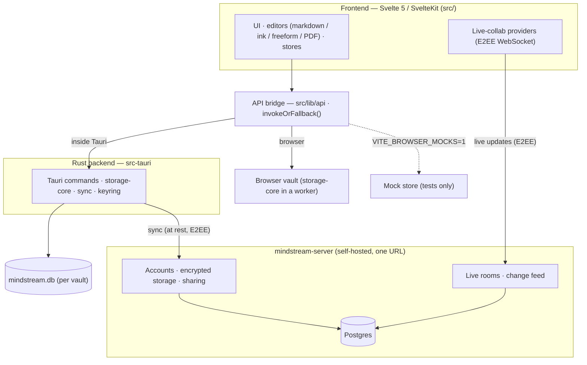

# Architecture

How Mindstream Notes fits together, end to end. For setup and builds see
[BUILDING.md](../BUILDING.md); for the by-design trade-offs the sync/history model
carries see [limitations.md](limitations.md); for the trust boundaries and the
security risks we accepted see [security-review.md](security-review.md).

## The big ideas

- **Local-first.** The local SQLite database is the source of truth. The app is
  fully usable with no account; sync is additive, not required.
- **CRDT note bodies.** Every note body is a Yjs/yrs document, so concurrent
  edits (across devices, or live between peers) merge instead of clobbering.
- **Optional end-to-end-encrypted sync.** When signed in, the server only ever
  stores ciphertext, both at rest and in live rooms. It knows who is in a room
  and who may write, but not what they write.
- **One storage core, two hosts.** The same Rust storage code runs natively
  inside Tauri and, compiled to Wasm, in a browser worker on SQLite over OPFS.

## Repository layout

```text
src/                    Svelte app: UI components, stores, editors, API bridge
  lib/onboarding/demo-notes/  Welcome Markdown bundled with setup
src-tauri/              Tauri app: commands, sync, sharing, vault runtime
  storage-core/         Notes, assets, history, search, import, migrations
  browser-wasm/         Storage core compiled for the browser worker
  plugin-runtime/       The Wasm plugin host
backend/server/         The sync server (AGPL-3.0), see server-design.md
backend/scripts/        Driver for the disposable server the e2e suites use
plugins/                Plugins bundled with the app, with their built .wasm
plugin-sdk/             Plugin SDKs, the WIT contract, shipped plugin sources
packages/svelte-kanban/ Fork of the board renderer
protocol/               The room protocol and invite-link format, specified once
vendor/etebase-rs/      The Etebase client library, changed here
e2e-tests/              Browser, backend and real-app end-to-end suites
docs/                   This documentation
```

## Layers



## Desktop vault runtime

An ordinary desktop launch elects one coordinator for its environment root.
The coordinator owns the vault index, desktop integrations and root recovery.
Each open vault has its own worker process, holding an OS lock on the vault,
its own SQLite connection and settings, and its own browser store. Main and
note popout windows share that worker. Mobile and isolated e2e devices run a
single vault directly; pass `--supervised-vaults` to test several vaults in one
root.

Switching vaults in one window saves and closes the source worker before the
target is shown, through a durable `vault-handoff.json` record that startup can
resume. A record that is corrupt or names another root, vault or build is set
aside as `<name>.unresumable-<uuid>`, so recovery never blocks startup. A main
window hidden to the tray for 15 minutes with no popout open is destroyed while
its worker keeps syncing (see [memory.md](memory.md)). Once its last worker
exits the coordinator exits too, unless close-to-tray is on.

Locks, root documents, startup and deletion are in
[storage ownership and recovery](storage-ownership-and-recovery.md).

## Frontend (`src/`)

Svelte 5 + SvelteKit render the UI. Editors are surface-specific: markdown uses
Milkdown/ProseMirror with `y-prosemirror`; ink is a Svelte canvas driven by
Pointer Events, with an Android-only Kotlin `CanvasFrontBufferedRenderer`
overlay for live-stroke latency; freeform embeds an Excalidraw island; PDFs
render through pdf.js.

- **API bridge — [`src/lib/api/`](../../src/lib/api).** One thin module per
  command surface (`notes.ts`, `collections.ts`, `sharing.ts`, …). Each call goes
  through `invokeOrFallback` in [`api/core.ts`](../../src/lib/api/core.ts).
  Inside Tauri it `invoke()`s the Rust command. In a browser it sends the
  command to the browser vault ([`src/lib/browser/`](../../src/lib/browser)),
  which runs the same storage core compiled to Wasm. Unit tests and the
  `VITE_BROWSER_MOCKS=1` fixture suite (`pnpm dev:fixtures`) use the in-memory
  [`api/mock-store.ts`](../../src/lib/api/mock-store.ts) instead.
- **Stores — [`src/lib/stores/`](../../src/lib/stores).** Svelte-runes state
  (`.svelte.ts`): the note tree, the active note source/status, the note-history
  bridge, profiles, signatures.
- **Live-collab providers — [`src/lib/sync/`](../../src/lib/sync).**
  [`collab-provider.ts`](../../src/lib/sync/collab-provider.ts) (markdown/PDF) and
  `ink-web-collab-provider.ts` talk to a note's room through
  [`room-socket.ts`](../../src/lib/sync/room-socket.ts). Every Yjs update is
  AES-GCM-encrypted under a key derived from the note's own key, which the
  server never has; the frame layout is in that file's header.

## The IPC boundary

The frontend never imports Rust directly — it `invoke()`s `#[tauri::command]`
functions. Errors flow back through `AppError`
([`src-tauri/src/error.rs`](../../src-tauri/src/error.rs)), which maps Rust errors
to IPC error strings. Note data lives in SQLite. Root/vault configuration and
recovery records use locked filesystem documents; the frontend holds view state
and pending edits.

## Rust backend

Storage lives in [`src-tauri/storage-core/`](../../src-tauri/storage-core/src),
shared by the native app and the browser build: notes, folders, assets,
history, search, import, backup merge, the yrs document and the SQLite
migrations. The modules in `src-tauri/src/` with the same names are thin Tauri
adapters around it. Natively, one SQLite `Connection` sits behind a `Mutex` on
the app state ([`db/mod.rs`](../../src-tauri/src/db/mod.rs)), held only for a
single query.

- **Assets.** An asset is kept while any note references it (the `asset_refs`
  table, not the note that created it) and is stored by content hash, so
  identical bytes within one share scope are stored once.
- **Note history.** Point-in-time DEFLATE-compressed snapshots of a note's
  markdown in `note_versions`. Deliberately **local and never synced**: each
  device keeps its own timeline. A _restore_ is applied by the editor as a
  normal CRDT edit, so the restored content converges across devices through
  the ordinary sync path (replaying an old CRDT state blob would be a no-op).
- **Vaults — [`profiles.rs`](../../src-tauri/src/profiles.rs).** Each vault is a
  self-contained directory `…/profiles/<id>/` with its own `mindstream.db`,
  account session, settings and backups. A `profiles.json` index at the app-data
  root records the last-used vault; live ownership comes from OS locks, not
  this index. `MINDSTREAM_PROFILE_DIR` (dev/e2e only) selects a vault directory;
  `MINDSTREAM_ROOT_DIR` separately isolates root documents and credentials for
  real-app test devices.
- **Auth — [`auth/mod.rs`](../../src-tauri/src/auth/mod.rs).** The password is
  never stored: a random 32-byte key encrypts the saved account state; the
  **key** goes in the OS keystore (Credential Manager / Keychain / Secret
  Service) and the **encrypted blob** + username + server URL go in
  `etebase.session`. Both halves are required to unlock, so leaking the file
  alone yields nothing.
- **Search.** Free-text matcher in `storage-core/src/search.rs`: AND token
  semantics, score `+10` per title hit / `+1` per body hit, with snippet +
  highlight ranges. [`api/search-matcher.ts`](../../src/lib/api/search-matcher.ts)
  mirrors it for the mock store (kept aligned by tests).
- **Backup — [`backup/`](../../src-tauri/src/backup).** A zip of `manifest.json`,
  a `data.db` snapshot and, from format 2, the portable settings and plugin
  files. Import supports preview, staged-restart restore and in-process merge.
  See [backup portability](backup-restore-portability.md).
- **Import — [`import`](../../src-tauri/storage-core/src/import.rs).** Markdown
  folders, Obsidian, Joplin and Evernote, in Rust because the target is a
  million-note vault. See [import-performance.md](import-performance.md).
- **Also here:** PDF text extraction (`pdf_text.rs`), vault export
  (`notes_export.rs`), the macOS native menu (`native_menu.rs`), tray, hotkeys,
  and desktop settings. Exporting a single note to PDF or other formats happens
  in the frontend ([`src/lib/note-exporters/`](../../src/lib/note-exporters)).

## The CRDT document model

A note body is a `yrs::Doc`, wrapped by
[`yrs_doc.rs`](../../src-tauri/storage-core/src/yrs_doc.rs) so nothing else
imports `yrs`. The wire format is the **v1** update encoding to match what the
JS editor produces. This encoded state is the source of truth that travels in
sync.

Markdown notes are schema 2: the editor owns a `prosemirror` XML fragment and
saves its own Yjs state through `y-prosemirror`. Schema 1 is a single `body`
Y.Text. Writers that only send a new body, such as programmatic edits, take
that path: Rust diffs old against new with `similar` and replays the edits on
the Y.Text, and the row is stamped schema 1 so the editor does not try to read
it as a fragment (`storage-core/src/notes.rs`).

## Sync

- **Vault sync — [`sync/mod.rs`](../../src-tauri/src/sync/mod.rs).** One Etebase
  collection, `mindstream.vault`, backs the local store. What an item is sits in
  its metadata: a folder (placement metadata), a note (a msgpack `NotePayload`
  carrying the yrs CRDT state plus parent/position/tags/trash), an attachment or
  a signature. Each sync finds or creates the collection, pulls by its one
  `stoken` and applies what came kind by kind
  ([`sync/pull.rs`](../../src-tauri/src/sync/pull.rs)), so a note's folder is in
  place before the note. It then pushes dirty rows via
  `ItemManager::transaction`, folders first. On a `Conflict` it refetches
  the item, merges the remote CRDT state into the local one (or takes remote
  non-CRDT fields for metadata-only rows), and retries — optimistic concurrency
  with the CRDT doing the actual conflict-free merge.
- **Live collaboration.** The collab providers exchange encrypted Yjs updates
  through the note's room on the server (above), separate from at-rest sync.

## Sharing a folder

A shared folder ([`sharing/`](../../src-tauri/src/sharing),
[`sync/scopes.rs`](../../src-tauri/src/sync/scopes.rs)) is one collection of
type `mindstream.shared`. Its folders, notes and attachments are items in it,
told apart by type exactly as in the vault, and its content is a small manifest
naming the root folder and who shared it. So sharing is one invitation and one
membership, with no state in which someone holds part of a folder.

Sharing **re-homes** the subtree: every row under the root is stamped with the
collection's uid as `share_scope_id` and detached from the vault, and
`sync::scopes` pushes and pulls it there. Items created in or moved into a
shared folder later inherit the scope. A row carries one `share_scope_id` or
none, so it lives in exactly one collection. Scoped sync is best effort: an
error there is logged, never propagated, so a broken share can't wedge the
user's own vault sync.

## The backend stack

The optional server ([`backend/`](../../backend/README.md)) is one program on
Postgres behind **one URL**. It keeps accounts and encrypted storage, speaking
the protocol of the Etebase client library the app ships, and it hosts the
live rooms that notes of every kind are co-edited in. The client is configured
with just that URL.

A room is a note's item on the server. The Rust side asks for a ticket with
the session it holds and hands it to the editor, which opens the room socket
with it, so the session token never reaches the WebView. The server knows who
is in a room and drops document changes from members who may only read. Frames
stay encrypted under a key derived from the note's own, which the server never
has.

The design and the reasons for it are in [server-design.md](server-design.md).
Running one is covered in the [self-hosting quick start](../self-hosting.md).

## How this shapes testing

The layering maps directly onto the [test tiers](e2e/strategy.md): pure logic is
unit-tested (T1); the mock store lets Playwright exercise the whole UI without
a backend (T2); the real IPC + SQLite + restart path needs the packaged binary
(T3); and sync/sharing/live-collab convergence needs two real clients plus the
backend stack (T4). See [e2e-tests/README.md](../../e2e-tests/README.md) to run
them.
